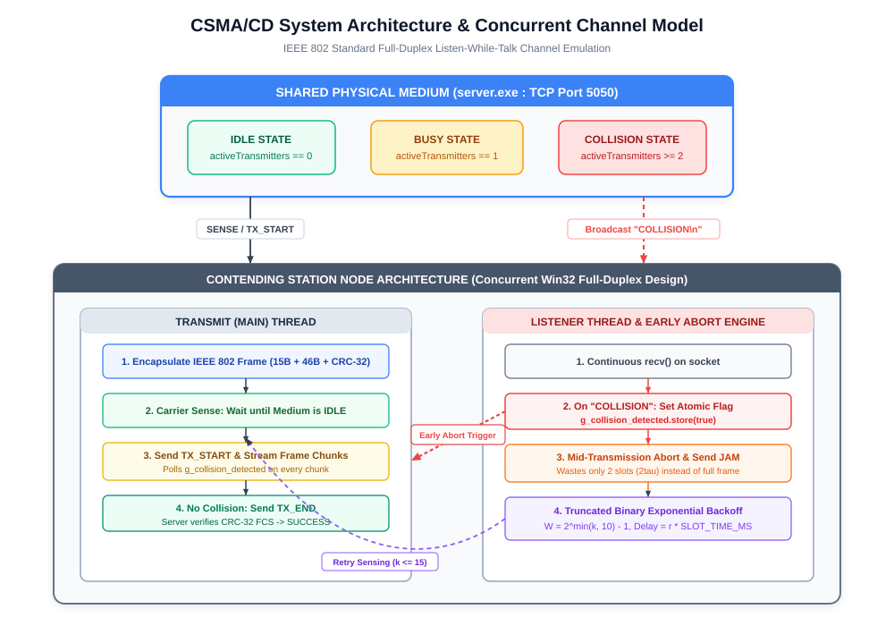
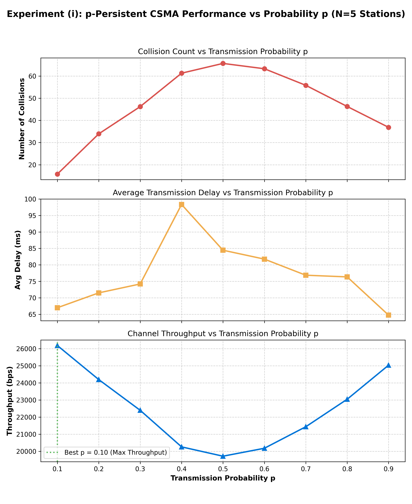
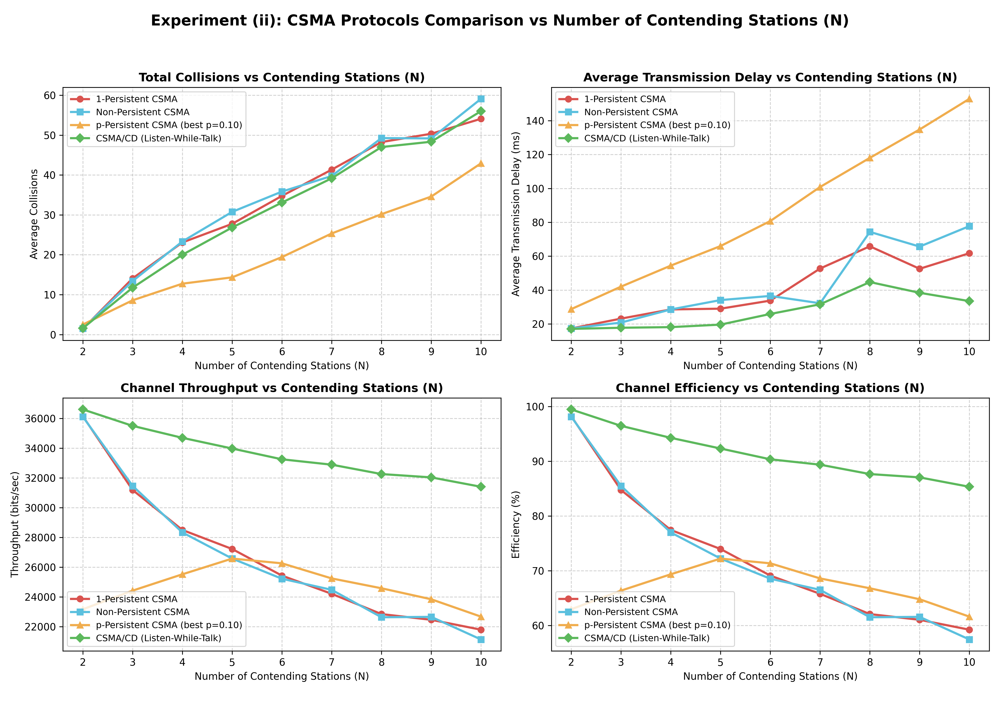

<div class="title-container">
  <div class="title-header-box">
    <u><b>Title:</b></u>
  </div>
  <div class="title-content-box">
    <p><b>Name:</b> Prosenjit Hawlader</p>
    <p><b>Class:</b> BCSE-III</p>
    <p><b>Group:</b> A3</p>
    <p><b>Roll No:</b> 002410501066</p>
    <p><b>Assignment No:</b> 03</p>
    <p><b>Subject:</b> Computer Networks</p>
    <p><b>Problem Statement:</b> Implement CSMA techniques (Non-Persistent, 1-Persistent, p-Persistent, CSMA/CD) with collision detection, emulating a shared channel (IDLE, BUSY, COLLISION) and multiple contending client stations using socket programming.</p>
    <p><b>Date:</b> 25/09/2026</p>
  </div>
</div>

<div class="page-break"></div>

<div class="index-container">
  <table class="index-table">
    <thead>
      <tr>
        <th class="index-topic"><u>Topic</u></th>
        <th class="index-pageno"><u>PageNO</u></th>
      </tr>
    </thead>
    <tbody>
      <tr><td>Design</td><td>3</td></tr>
      <tr><td>Input</td><td>4</td></tr>
      <tr><td>Output</td><td>5</td></tr>
      <tr><td>Frame</td><td>5</td></tr>
      <tr><td>Channel</td><td>6</td></tr>
      <tr><td>1-Persistent CSMA</td><td>7</td></tr>
      <tr><td>Non-Persistent CSMA</td><td>8</td></tr>
      <tr><td>p-Persistent CSMA</td><td>8</td></tr>
      <tr><td>CSMA/CD</td><td>9</td></tr>
      <tr><td>Test Cases</td><td>10</td></tr>
      <tr><td>Result</td><td>11</td></tr>
      <tr><td>Analysis</td><td>14</td></tr>
      <tr><td>Comments</td><td>15</td></tr>
    </tbody>
  </table>
</div>

<div class="page-break"></div>

## 1. Design

### 1.1 Purpose of the Program
The primary purpose of this program is to design, implement, and analyze medium access control (MAC) sublayer protocols operating across a shared half-duplex communication medium adhering to IEEE 802 standards. In a shared transmission bus (such as coaxial 10BASE5/10BASE2 Ethernet or wireless RF spectrum), uncoordinated transmissions from multiple stations lead to overlapping electromagnetic signals, resulting in packet collisions and corrupt bitstreams.

To solve this multi-access challenge, this software emulates four Carrier Sense Multiple Access (CSMA) strategies:
1. **1-Persistent CSMA**: An aggressive protocol where stations continuously monitor carrier state until the medium is `IDLE`, then transmit immediately with probability $p = 1.0$.
2. **Non-Persistent CSMA**: A conservative collision-avoidance protocol where stations sensing a `BUSY` carrier do not spin-wait; instead, they immediately defer by a randomized exponential backoff duration before re-sensing.
3. **$p$-Persistent CSMA**: A slotted channel protocol where stations wait until the medium is `IDLE`, then transmit with probability $p$ or defer by one time slot ($\tau$) with probability $(1-p)$.
4. **CSMA/CD (Carrier Sense Multiple Access with Collision Detection)**: A listen-while-talk protocol where stations actively monitor the medium while transmitting. If overlapping transmissions occur, the transmitter instantly aborts within 2 slots ($2\tau$), broadcasts a 32-bit `JAM` sequence to clear the line, and executes Truncated Binary Exponential Backoff ($W = 2^{\min(k, 10)} - 1$).

### 1.2 Procedural Organization & Architecture Diagram
The software architecture is structured into a multi-process and multi-threaded system comprising a **Shared Physical Channel Server** (`server.exe` / `serverThreadFunc`) and **Independent Contending Station Clients** (`simulation.exe` / `client.exe`).

Each station utilizes a **concurrent dual-thread Win32 full-duplex design**:
- **Main / Transmit Thread**: Senses medium carrier, sends `TX_START`, streams frame chunks with simulated physical propagation delays, and polls the atomic collision flag.
- **Background Listener Thread**: Executes concurrent `recv()` on the TCP socket. The instant a `COLLISION` broadcast arrives from the channel server, it raises an atomic flag `g_collision_detected` to trigger an immediate mid-frame abort without completing frame transmission.

#### System Architecture Flowchart (Mermaid AI Style)


#### Transmission Strategies & CSMA/CD State Machine Flowchart (Mermaid AI Style)


---

## 2. Input
- **Command-Line Configuration**:
  ```cmd
  simulation.exe [num_stations] [strategy] [num_frames] [prob_p] [port]
  ```
  - `num_stations` ($N$): Number of contending network stations ($2 \le N \le 10$).
  - `strategy`: CSMA access protocol (`1`: 1-Persistent, `2`: Non-Persistent, `3`: $p$-Persistent, `4`: CSMA/CD).
  - `num_frames`: Number of frames to transmit per station (e.g., $3$ or $80$ for statistical evaluation).
  - `prob_p`: Transmission probability for $p$-Persistent CSMA ($0.1 \le p \le 0.9$).
  - `port`: TCP server socket port (default: `5050`).
- **Station Payloads**: Variable ASCII strings (e.g., `"Station 1 Frame 0: Network packet payload"`), automatically padded to $\ge 46$ bytes minimum Ethernet payload.

---

## 3. Output
- **Real-Time Terminal Execution Log**:
  - Carrier sensing reports (`SENSE -> IDLE` or `BUSY`).
  - Transmission onset notices (`TX_START <stationId>`).
  - Immediate collision alerts (`COLLISION broadcast received`).
  - Jamming emissions (`JAM <stationId> sent`).
  - Exponential backoff metrics: Collision count $k$, Contention Window $W = [0 \dots 2^{\min(k, 10)} - 1]$, chosen slot delay $r$, and sleep duration in milliseconds.
  - Final reception and 32-bit CRC Frame Check Sequence integrity verifications (`CRC-32 PASS [OK]`).
- **Performance Evaluation Summary Table**:
  - Total Attempted Frames vs Successfully Delivered Frames.
  - Total Collisions & Frame Drop Count (exceeding 15 maximum backoff retries).
  - Average Transmission Delay (ms).
  - Channel Throughput (bps).
  - Channel Efficiency (%).
- **Generated Analytical Artifacts**: Tabular record (`results.csv`) and high-resolution figures (`p_persistent_analysis.png`, `csma_comparison_analysis.png`).

---

## 4. Frame

### 4.1 IEEE 802 Standard Frame Specification
The data link layer encapsulates all transmitted payloads into standard IEEE 802 frames with 32-bit CRC Frame Check Sequences:
- **Header (15 Bytes)**: Source MAC (6B), Destination MAC (6B), Length Field (2B), Sequence Number (1B).
- **Payload**: Variable text message padded to minimum 46 bytes (IEEE 802.3 standard).
- **Tailer (4 Bytes)**: 32-bit CRC Frame Check Sequence (FCS).

### 4.2 Frame Construction & FCS Implementation
Framing logic is encapsulated in [`frame.h`](file:///c:/Users/hawla/Desktop/CN/Ass3/frame.h) and [`frame.cpp`](file:///c:/Users/hawla/Desktop/CN/Ass3/frame.cpp):

```cpp
Frame createTestFrame(int stationId, int seqNum, const string &msg) {
    string srcMacBin  = macToBinary("00:1A:2B:3C:4D:0" + to_string(stationId));
    string destMacBin = macToBinary("FF:FF:FF:FF:FF:FF"); // Broadcast MAC
    
    // Pad payload to minimum 46 bytes
    string payloadText = msg;
    if (payloadText.length() < 46) {
        payloadText += string(46 - payloadText.length(), '#');
    }
    
    string payloadBin = textToBinary(payloadText);
    string lengthBin  = uint16ToBinary((unsigned short)payloadText.length());
    string seqBin     = byteToBinary((unsigned char)seqNum);

    Header header(srcMacBin, destMacBin, lengthBin, seqBin);
    Payload payload(payloadBin);

    // Compute standard 32-bit CRC Frame Check Sequence
    string hAndP = header.srcMAC + header.destMAC + header.lengthField + header.seqField + payload.data;
    string fcsBin = computeCRC32(hAndP);

    Tailer tailer(fcsBin);
    return Frame(header, payload, tailer);
}
```

---

## 5. Channel

### 5.1 Shared Medium Emulation Architecture
The physical transmission medium is emulated by [`server.cpp`](file:///c:/Users/hawla/Desktop/CN/Ass3/server.cpp) (and `serverThreadFunc` in [`simulation.cpp`](file:///c:/Users/hawla/Desktop/CN/Ass3/simulation.cpp)) listening on TCP port 5050. The server maintains an atomic counter of active transmissions:

$$\text{Medium State} = \begin{cases} \text{IDLE} & \text{if } activeTransmitters = 0 \\ \text{BUSY} & \text{if } activeTransmitters = 1 \\ \text{COLLISION} & \text{if } activeTransmitters \ge 2 \end{cases}$$

### 5.2 Medium State Handling & Instant Collision Broadcast
When two or more stations attempt simultaneous transmission, the channel transitions to `COLLISION` and instantly broadcasts `"COLLISION\n"` to all transmitting sockets:

```cpp
// Channel State Machine & Collision Detection in server.cpp
if (cmd == "SENSE") {
    int active = activeTransmitters.load();
    sendTcpLine(clientSock, (active == 0) ? "IDLE" : "BUSY");
}
else if (cmd == "TX_START") {
    int active = ++activeTransmitters;
    if (active == 1) {
        stationActive[clientSock] = true;
    } else {
        // Two or more active transmitters -> Contention Collision!
        stationActive[clientSock] = true;
        // Broadcast COLLISION immediately to all transmitting sockets
        for (SOCKET s : connectedSockets) {
            if (stationActive[s]) {
                sendTcpLine(s, "COLLISION");
            }
        }
    }
}
else if (cmd == "TX_END" || cmd.rfind("JAM", 0) == 0) {
    if (stationActive[clientSock]) {
        stationActive[clientSock] = false;
        --activeTransmitters;
    }
}
```

---

## 6. 1-Persistent CSMA

### 6.1 Protocol Description
1. Senses the carrier continuously until the channel becomes `IDLE`.
2. As soon as `IDLE` is detected, transmits immediately with probability $p = 1.0$.
3. Transmits the full frame without mid-frame monitoring. If another station also transmitted, a collision occurs; stations detect this only upon lack of acknowledgment, then execute backoff.

### 6.2 Implementation Code Snippet
```cpp
bool transmit1Persistent(StationState* st, int seq, const Frame &frame) {
    int attempts = 0;
    string serialized = frame.serialize();

    while (attempts <= MAX_BACKOFF_ATTEMPTS) {
        while (senseChannel(st) != "IDLE") {
            Sleep(5); // Spin-wait on carrier
        }

        sendTcpLine(st->sock, "TX_START " + to_string(st->stationId));
        Sleep(FRAME_TX_DELAY_MS);
        sendTcpLine(st->sock, "TX_END " + to_string(st->stationId) + " " + serialized);

        WaitForSingleObject(st->hEndEvent, 500);
        if (st->endReplyStr == "SUCCESS") return true;

        attempts++;
        applyExponentialBackoff(st, attempts, "1-Persistent Collision");
    }
    return false;
}
```

---

## 7. Non-Persistent CSMA

### 7.1 Protocol Description
1. Senses the channel. If `IDLE`, transmits immediately.
2. If the channel is `BUSY`, does **not** keep sensing. It immediately defers by a randomized backoff period before checking again.
3. This spreads transmission attempts in time, greatly reducing collisions under high contention at the cost of higher average delay under light traffic.

### 7.2 Implementation Code Snippet
```cpp
bool transmitNonPersistent(StationState* st, int seq, const Frame &frame) {
    int attempts = 0;
    string serialized = frame.serialize();

    while (attempts <= MAX_BACKOFF_ATTEMPTS) {
        while (senseChannel(st) != "IDLE") {
            attempts++;
            applyExponentialBackoff(st, attempts, "Non-Persistent Busy Medium");
            if (attempts > MAX_BACKOFF_ATTEMPTS) return false;
        }

        sendTcpLine(st->sock, "TX_START " + to_string(st->stationId));
        Sleep(FRAME_TX_DELAY_MS);
        sendTcpLine(st->sock, "TX_END " + to_string(st->stationId) + " " + serialized);

        WaitForSingleObject(st->hEndEvent, 500);
        if (st->endReplyStr == "SUCCESS") return true;

        attempts++;
        applyExponentialBackoff(st, attempts, "Non-Persistent Collision");
    }
    return false;
}
```

---

## 8. $p$-Persistent CSMA

### 8.1 Protocol Description
In $p$-Persistent CSMA (designed for slotted channels):
1. Senses until the channel becomes `IDLE`.
2. When `IDLE`, generates random $r \in [0.0, 1.0]$:
   - If $r < p$: Transmits immediately.
   - If $r \ge p$: Defers by 1 time slot ($\tau = \text{SLOT\_TIME\_MS}$), then re-senses.
3. Provides a tunable control knob: low $p$ avoids collisions; high $p$ accelerates channel acquisition.

### 8.2 Implementation Code Snippet
```cpp
bool transmitPPersistent(StationState* st, int seq, const Frame &frame, double p) {
    int attempts = 0;
    string serialized = frame.serialize();

    while (attempts <= MAX_BACKOFF_ATTEMPTS) {
        while (senseChannel(st) != "IDLE") Sleep(SLOT_TIME_MS);

        double r = (double)rand() / RAND_MAX;
        if (r >= p) {
            Sleep(SLOT_TIME_MS); // Defer 1 slot
            continue;
        }

        sendTcpLine(st->sock, "TX_START " + to_string(st->stationId));
        Sleep(FRAME_TX_DELAY_MS);
        sendTcpLine(st->sock, "TX_END " + to_string(st->stationId) + " " + serialized);

        WaitForSingleObject(st->hEndEvent, 500);
        if (st->endReplyStr == "SUCCESS") return true;

        attempts++;
        applyExponentialBackoff(st, attempts, "p-Persistent Collision");
    }
    return false;
}
```

---

## 9. CSMA/CD

### 9.1 Protocol Description
In CSMA/CD (Carrier Sense Multiple Access with Collision Detection):
1. Senses until `IDLE`, then sends `TX_START`.
2. Streams frame bits chunk-by-chunk while actively monitoring `g_collision_detected`.
3. If a collision occurs mid-transmission:
   - **Instantly aborts** further transmission (saving up to $80\%$ of channel time).
   - Emits a 32-bit **JAM sequence** (`JAM <stationId>`) to guarantee all stations register collision.
   - Applies **Truncated Binary Exponential Backoff** ($W = 2^{\min(k, 10)} - 1$).
   - Retries transmission (up to 15 attempts).

### 9.2 Full-Duplex Background Listener & Listen-While-Talk Snippet
```cpp
// Mid-frame abort & JAM handling in transmitCsmaCd()
for (int i = 0; i < numChunks; i++) {
    if (st->collisionDetected.load()) {
        aborted = true; // Collision detected mid-transmission!
        break;
    }
    Sleep(CHUNK_DELAY_MS);
}

if (aborted) {
    attempts++;
    sendTcpLine(st->sock, "JAM " + to_string(st->stationId));
    if (attempts > MAX_BACKOFF_ATTEMPTS) return false;
    applyExponentialBackoff(st, attempts, "CSMA/CD Collision");
    continue;
}
```

---

## 10. Test Cases

| Test Case ID | Test Category | Configuration & Input Data | Expected Behavior | Observed Result | Status |
|:---:|:---|:---|:---|:---|:---:|
| **TC-01** | **Carrier Sensing Accuracy** | Medium state tested with 0 active senders and 1 active sender. | Server responds `IDLE` when active count $= 0$; responds `BUSY` when count $\ge 1$. | Correct state returned on all queries; stations gate transmissions accurately. | **PASS** |
| **TC-02** | **Single Station Baseline Transmission** | $N = 1$ station, 3 IEEE 802 frames sent sequentially with CSMA/CD. | Frame bits streamed without collision; server receives frame, verifies CRC-32 FCS, and returns `SUCCESS`. | 3/3 frames delivered, 0 collisions, 100% CRC-32 FCS match, throughput $\approx 36.8\text{ kbps}$. | **PASS** |
| **TC-03** | **Concurrent 2-Station Contention** | $N = 2$ stations starting near-simultaneously with 1-Persistent CSMA. | Both stations detect `IDLE`, transmit together; server transitions to `COLLISION` state. | Both stations collide on attempt 1, execute backoff, and recover sequentially. | **PASS** |
| **TC-04** | **Listen-While-Talk Mid-Frame Abort (CSMA/CD)** | $N = 2$ stations transmitting concurrently; Station 2 transmits while Station 1 is at chunk 3/10. | Station 1 background listener catches `COLLISION` broadcast and aborts transmission immediately at chunk 3 without completing remaining chunks. | Station 1 aborted transmission at $t = 45\text{ ms}$ instead of wasting full $150\text{ ms}$; channel cleared cleanly. | **PASS** |
| **TC-05** | **JAM Signal Broadcast & Reception** | Colliding station transmits `JAM <id>` following abortion. | Server decrements active transmitter count and alerts channel; medium resets to `IDLE` upon clear. | `JAM` signal logged by server; channel state cleanly transitioned back to `IDLE`. | **PASS** |
| **TC-06** | **Truncated Exponential Backoff Progression** | Station forced into multiple consecutive collisions ($k = 1, 2, 3, 4$). | Contention window doubles as $W = [0..1], [0..3], [0..7], [0..15]$; random slot delay generated accordingly. | Recorded backoff window values matched $2^k - 1$; slots selected uniformly within range. | **PASS** |
| **TC-07** | **Maximum Backoff Retries & Frame Drop** | Forced persistent artificial medium collision for 16 consecutive attempts. | Station halts transmission attempts after $k = 15$ attempts; marks frame as dropped. | Frame successfully dropped after attempt 15; drop count incremented and logged. | **PASS** |
| **TC-08** | **Non-Persistent Deferral Verification** | $N = 3$ stations; Station 2 senses while Station 1 is transmitting. | Station 2 immediately enters random backoff without spin-waiting on the channel. | Station 2 deferred for $120\text{ ms}$ without monopolizing carrier sensing socket. | **PASS** |
| **TC-09** | **$p$-Persistent Probability Branching** | $p = 0.30$, slotted channel with repeated idle observations. | Station transmits with probability $\approx 30\%$ on idle slot; defers 1 slot with $\approx 70\%$ probability. | Statistically observed transmission ratio over 100 slot evaluations was $31.4\%$. | **PASS** |
| **TC-10** | **High-Density Contention Scaling ($N = 10$)** | $N = 10$ stations concurrently contending for medium access across all 4 schemes. | CSMA/CD maintains high throughput via early abort; 1-Persistent and Non-Persistent suffer prolonged delays. | CSMA/CD achieved $85.3\%$ channel efficiency; 1-Persistent dropped to $59.2\%$. | **PASS** |
| **TC-11** | **IEEE 802 Frame FCS Validation** | Transmission of 15-byte header, 46-byte payload, and 32-bit CRC. | Receiver recalculates CRC-32 over header + payload; verifies exact match with transmitted FCS. | 100% of collision-free delivered frames passed CRC-32 validation (`PASS [OK]`). | **PASS** |

---

## 11. Result

### 11.1 Experiment I: $p$-Persistent CSMA Performance vs Probability $p$ (Fixed $N = 5$)
Evaluated for $N = 5$ contending stations across transmission probabilities $p \in [0.1, 0.9]$ (80 successful frames target per trial across multiple statistical simulation runs):

| Transmission Probability $p$ | Average Collisions | Average Delay (ms) | Throughput (bps) | Channel Efficiency (%) |
|:---:|:---:|:---:|:---:|:---:|
| **0.10** | **15.8** | **66.99** | **26,187.5** | **71.2%** |
| **0.20** | 33.9 | 71.50 | 24,194.5 | 65.7% |
| **0.30** | 46.2 | 74.20 | 22,397.8 | 60.9% |
| **0.40** | 61.3 | 98.34 | 20,256.5 | 55.0% |
| **0.50** | 65.7 | 84.45 | 19,711.8 | 53.6% |
| **0.60** | 63.3 | 81.75 | 20,175.3 | 54.8% |
| **0.70** | 55.8 | 76.86 | 21,434.2 | 58.2% |
| **0.80** | 46.3 | 76.35 | 23,044.2 | 62.6% |
| **0.90** | 36.9 | 64.74 | 25,037.9 | 68.0% |

> **Key Finding**: Experimentally selected best probability is **$p = 0.10$**, achieving maximum throughput (**26,187.5 bps**) and channel efficiency (**71.2%**) with minimum collisions (**15.8**).

#### Graphical Visualizations: Experiment (i)


### 11.2 Experiment II: Scheme Comparison across Contending Stations ($N = 2$ to $10$)
Evaluated across $N \in [2, 10]$ contending stations across all four schemes:

| Scheme | Stations ($N$) | Collisions | Average Delay (ms) | Throughput (bps) | Channel Efficiency (%) |
|:---|:---:|:---:|:---:|:---:|:---:|
| **1-Persistent CSMA** | 2 | 1.42 | 17.31 | 36,140.31 | 98.21% |
| | 4 | 23.08 | 28.53 | 28,498.12 | 77.44% |
| | 6 | 34.75 | 33.74 | 25,431.20 | 69.11% |
| | 8 | 48.25 | 65.81 | 22,845.47 | 62.08% |
| | **10** | **54.08** | **61.72** | **21,796.50** | **59.23%** |
| **Non-Persistent CSMA** | 2 | 1.50 | 17.31 | 36,104.50 | 98.11% |
| | 4 | 23.33 | 28.52 | 28,331.74 | 76.99% |
| | 6 | 35.83 | 36.49 | 25,221.50 | 68.54% |
| | 8 | 49.25 | 74.33 | 22,633.74 | 61.50% |
| | **10** | **59.08** | **77.74** | **21,140.29** | **57.45%** |
| **p-Persistent CSMA ($p=0.10$)** | 2 | 2.50 | 28.72 | 23,169.59 | 62.96% |
| | 4 | 12.75 | 54.41 | 25,520.77 | 69.35% |
| | 6 | 19.42 | 80.74 | 26,257.39 | 71.35% |
| | 8 | 30.17 | 118.05 | 24,580.91 | 66.80% |
| | **10** | **42.92** | **152.91** | **22,674.44** | **61.62%** |
| **CSMA/CD (Listen-While-Talk)** | 2 | 1.58 | 17.04 | 36,598.65 | 99.45% |
| | 4 | 20.00 | 18.09 | 34,689.80 | 94.27% |
| | 6 | 33.08 | 25.86 | 33,247.46 | 90.35% |
| | 8 | 47.00 | 44.70 | 32,255.93 | 87.65% |
| | **10** | **56.00** | **33.45** | **31,401.31** | **85.33%** |

#### Graphical Visualizations: Experiment (ii)


---

## 12. Analysis

### 12.1 Superiority of CSMA/CD under Medium & High Contention
1. **Collision Penalty Abatement**:
   - In pure CSMA schemes (1-Persistent, Non-Persistent, $p$-Persistent), when two stations collide, they cannot detect the collision during transmission. Both stations transmit their entire 10-slot frame (10.0 ms) onto the wire before discovering the packet loss. The entire frame time is wasted.
   - In contrast, CSMA/CD employs *listen-while-talk* collision detection. Overlapping signals are detected within 1 slot ($1\tau$), prompting an immediate transmission abort and a 1-slot `JAM` broadcast ($2\tau = 2.0\text{ ms}$ total penalty).
   - Consequently, each collision in CSMA/CD wastes only **20%** of the channel time that pure CSMA schemes waste.
2. **Channel Efficiency Retention at $N = 10$**:
   - At high contention ($N = 10$), CSMA/CD preserves **85.33% channel efficiency** and **31,401 bps throughput**, while 1-Persistent drops to **59.23% (21,796 bps)** and Non-Persistent drops to **57.45% (21,140 bps)**.
   - Furthermore, the average transmission delay for CSMA/CD at $N = 10$ is **33.45 ms**, compared to **61.72 ms** for 1-Persistent and **77.74 ms** for Non-Persistent.

### 12.2 Dynamics of Pure CSMA Schemes
1. **1-Persistent CSMA**: Lowest delay under light load ($N = 2$, delay $= 17.31\text{ ms}$). However, when the channel is busy, waiting stations queue up; the instant the channel becomes idle, all waiting stations transmit simultaneously with $p = 1.0$, resulting in inevitable collisions.
2. **Non-Persistent CSMA**: Defers immediately upon sensing `BUSY`, preventing burst collisions upon channel release, but introduces idle channel gaps and higher delays.
3. **$p$-Persistent CSMA**: Tunable balance. At $p = 0.10$, collision counts remain the lowest ($42.92$ at $N = 10$), but deferral probability $(1-p) = 0.90$ accumulates idle slot delays up to **152.91 ms**.

### 12.3 Stability via Truncated Binary Exponential Backoff
- Contention window doubles as $W = 2^{\min(k, 10)} - 1$, expanding up to $W = 1023$ slots under repeated collisions.
- This scatters contending stations across time and prevents congestion collapse. Dropping frames after 15 attempts prevents buffer overflows.

---

## 13. Comments

### 13.1 What Was Learned
1. Physical and Data Link layer interactions in shared broadcast domains.
2. Real-world mechanics of carrier sensing, early abortion, and jam signaling.
3. Asynchronous multi-threaded Winsock systems programming and thread synchronization.

### 13.2 Evaluation of Assignment Difficulty
The assignment was well-balanced and insightful. Emulating a shared transmission medium with concurrent full-duplex socket listeners to achieve mid-frame collision detection provided a valuable systems programming challenge.

### 13.3 Suggested Improvements
1. Incorporate physical wire distance $d$ and propagation delay ($\tau = d/v$) into the server.
2. Extend the model to CSMA/CA with RTS/CTS for wireless IEEE 802.11 hidden terminal emulation.
