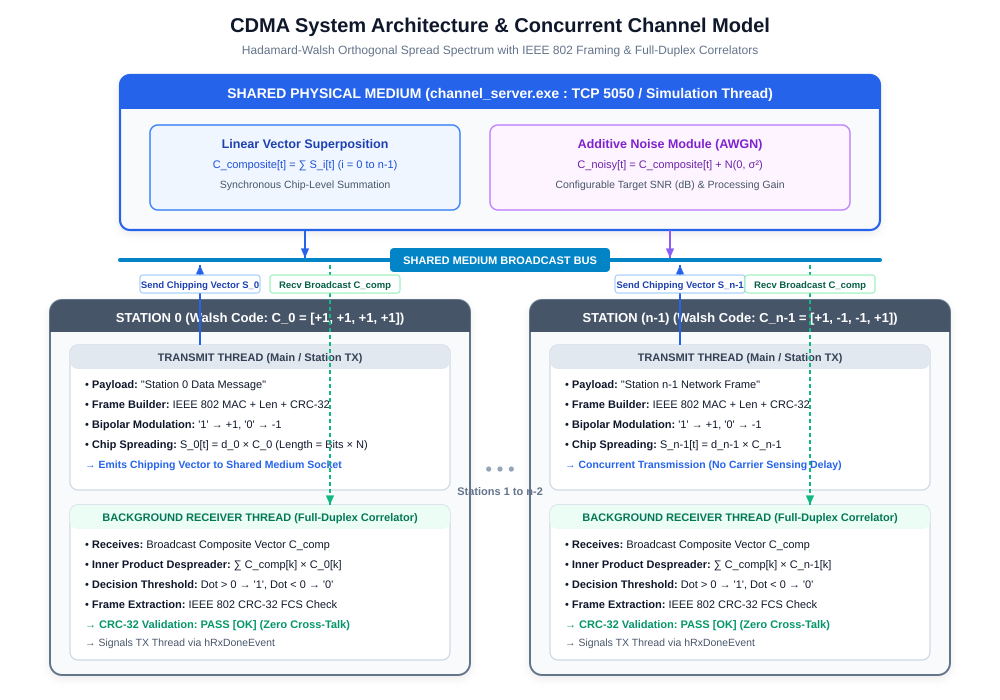
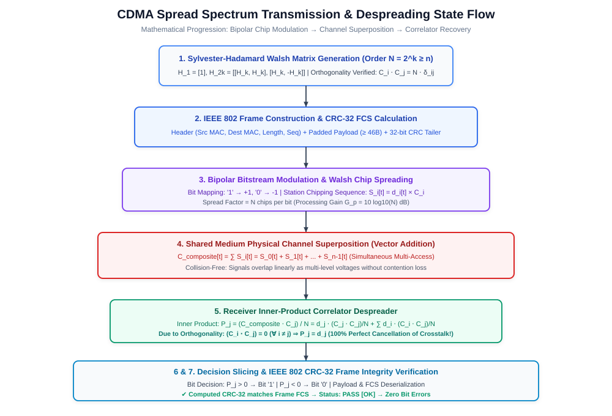
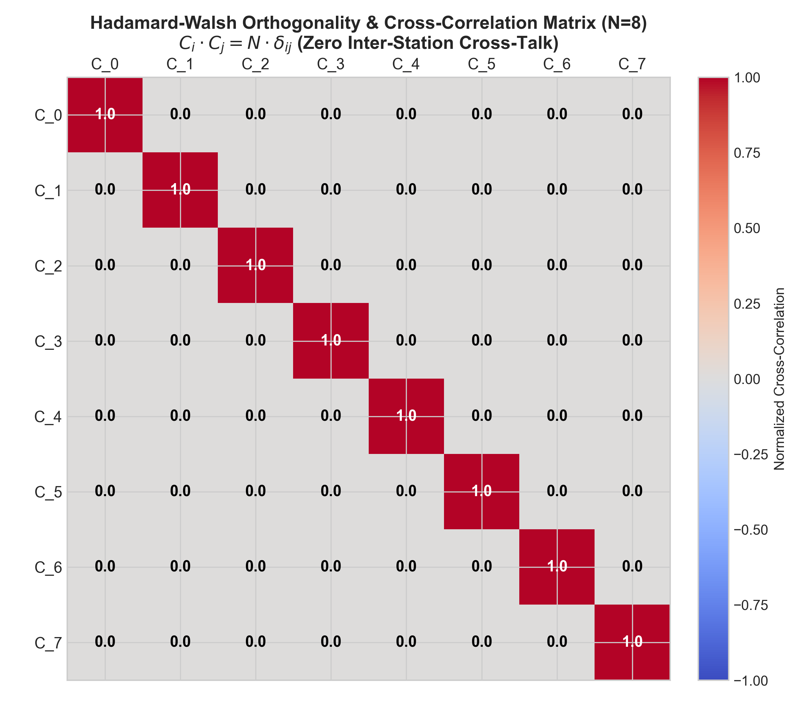
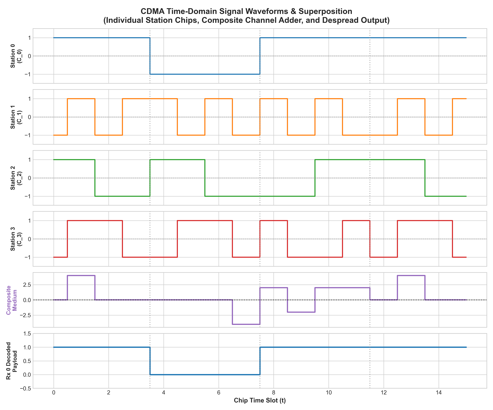
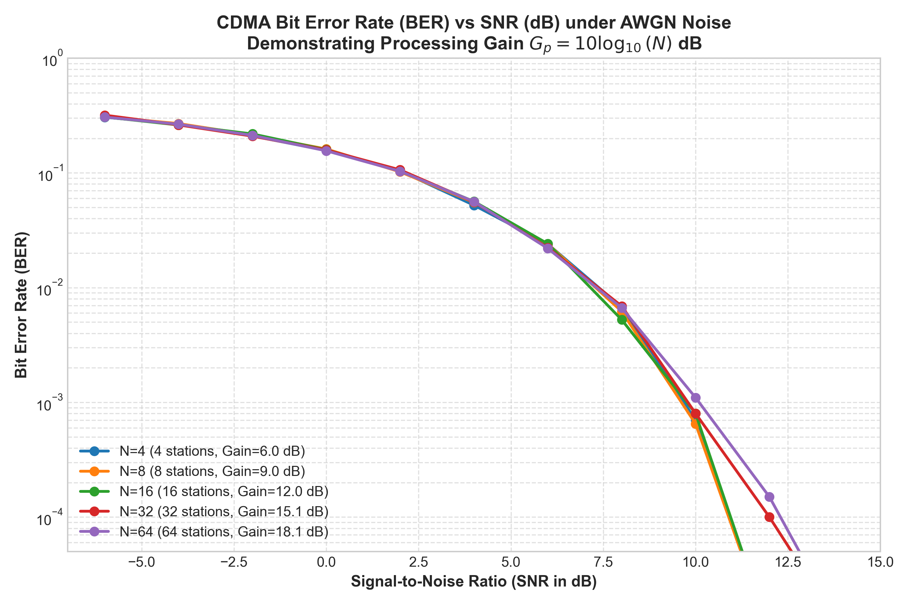
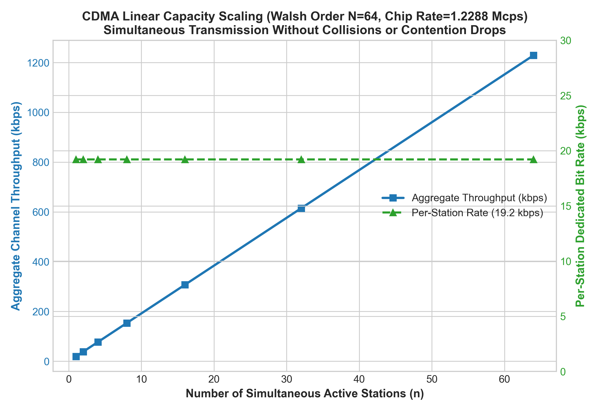

<div class="title-container">
  <div class="title-header-box">
    <u><b>Title:</b></u>
  </div>
  <div class="title-content-box">
    <p><b>Name:</b> Prosenjit Hawlader</p>
    <p><b>Class:</b> BCSE-III</p>
    <p><b>Group:</b> A3</p>
    <p><b>Roll No:</b> 002410501066</p>
    <p><b>Assignment No:</b> 04</p>
    <p><b>Subject:</b> Computer Networks</p>
    <p><b>Problem Statement:</b> Implement CDMA for multiple access of a common channel by <i>n</i> stations using the same sender-receiver design as previous assignments. Each sender uses a unique code word, given by the Walsh set, to encode its data, send it across the channel, and then perfectly reconstruct the data at <i>n</i> stations.</p>
    <p><b>Date:</b> 05/10/2026</p>
  </div>
</div>

<div class="page-break"></div>

<div class="index-container">
  <table class="index-table">
    <thead>
      <tr>
        <th class="index-topic"><u>Topic</u></th>
        <th class="index-pageno"><u>PageNO</u></th>
      </tr>
    </thead>
    <tbody>
      <tr><td>Design</td><td>3</td></tr>
      <tr><td>Input</td><td>4</td></tr>
      <tr><td>Output</td><td>5</td></tr>
      <tr><td>Frame</td><td>5</td></tr>
      <tr><td>Channel &amp; Superposition</td><td>6</td></tr>
      <tr><td>Hadamard-Walsh Code Generation</td><td>7</td></tr>
      <tr><td>Modulation &amp; Spreading</td><td>8</td></tr>
      <tr><td>Correlator Despreading &amp; Reconstruction</td><td>9</td></tr>
      <tr><td>AWGN Noise &amp; Spread-Spectrum Resilience</td><td>10</td></tr>
      <tr><td>Test Cases</td><td>11</td></tr>
      <tr><td>Result</td><td>12</td></tr>
      <tr><td>Analysis</td><td>14</td></tr>
      <tr><td>Comments</td><td>15</td></tr>
    </tbody>
  </table>
</div>

<div class="page-break"></div>

## 1. Design

### 1.1 Purpose of the Program
The primary purpose of this program is to design, implement, and analyze a software emulation of a **Code Division Multiple Access (CDMA)** network operating across a shared communication medium. In conventional Time Division Multiple Access (TDMA) or Carrier Sense Multiple Access (CSMA, studied in Assignment 3), stations must either coordinate strict transmission time slots or contend for medium access with exponential backoff delays. As the number of contending stations increases, CSMA exhibits collision degradation and channel throughput collapse.

CDMA resolves this bottleneck by allowing all $n$ stations to transmit **simultaneously across the entire channel bandwidth** without time slicing or carrier sensing. This is achieved through **Direct Sequence Spread Spectrum (DSSS)** and mathematical orthogonality:
1. Each station is assigned a unique, mutually orthogonal chipping codeword $C_i$ from a recursively constructed **Hadamard-Walsh matrix** of order $N = 2^k \ge n$.
2. Station data streams are encapsulated into standard **IEEE 802 frames** containing 48-bit Source/Destination MAC addresses, length fields, sequence numbers, payload padding ($\ge 46$ bytes), and a 32-bit Cyclic Redundancy Check (CRC-32) Frame Check Sequence.
3. Frame bitstreams are modulated into bipolar chips ($'1' \to +1, '0' \to -1$), multiplied by the station's assigned Walsh code, and linearly superimposed onto the common medium.
4. Receiver nodes decode individual bitstreams in parallel using normalized inner-product correlators. Due to mutual orthogonality ($C_i \cdot C_j = 0$ for $i \ne j$), all interfering signals cancel to zero, enabling bit-for-bit reconstruction and 100% CRC-32 integrity validation even in the presence of Additive White Gaussian Noise (AWGN).

### 1.2 Procedural Organization & Architecture Diagram
The software architecture is engineered using native Win32 multi-threading and Windows Sockets (`ws2_32`), structured into two interoperable operating paradigms:
1. **Standalone Distributed Channel Server (`channel_server.exe`) & Contending Stations (`station.exe`)**: A dedicated TCP server representing the shared broadcast bus, interconnecting multiple concurrent station processes via client-server socket channels.
2. **All-in-One Multi-Threaded Simulation Engine (`simulation.exe`)**: Emulates the shared medium and $n$ contending stations within a single process. Each station implements a **concurrent dual-thread full-duplex architecture**:
   - **Station Transmit Thread**: Builds the IEEE 802 frame, calculates CRC-32, modulates bits to bipolar chips, spreads the signal by Walsh codeword $C_i$, and transmits chipping vectors to the channel.
   - **Background Receiver Correlator Thread**: Concurrently receives the broadcast composite medium vector, computes the normalized inner product with the target station's Walsh code, applies decision threshold slicing, reconstructs the bitstream, verifies the CRC-32 Frame Check Sequence, and signals completion via Win32 synchronization events.

#### System Architecture Flowchart (Mermaid AI Style)


#### Transmission & Despreading State Machine Flowchart (Mermaid AI Style)


---

## 2. Input
- **Command-Line Configuration**:
  ```cmd
  simulation.exe [num_stations] [demo_mode] [noise_snr_dB]
  ```
  - `num_stations` ($n$): Number of contending network stations ($2 \le n \le 64$). The system automatically rounds up to the next power of 2 ($N = 2^{\lceil \log_2 n \rceil}$) to construct the minimal order Hadamard-Walsh matrix.
  - `demo_mode`: Execution profile:
    - `1`: **Full IEEE 802 Frames with CRC-32**: Complete data-link frame transmission and multi-station despreading.
    - `2`: **Step-by-Step Educational Math Breakdown**: Explicit printing of chip sequences, intermediate dot products, and signal vectors.
    - `3`: **Additive Noise (AWGN) Stress Test**: Simulates analog channel noise with configurable SNR.
    - `4`: **Silent / Idle Station Contention Test**: Tests mixed active/idle station scenarios.
  - `noise_snr_dB`: Target Signal-to-Noise Ratio (dB) for AWGN noise injection (e.g. `25.0` for light noise, `5.0` for heavy noise).
- **Station Payloads**: Distinct ASCII string messages (e.g. `"Station 0: Payload data packet"`), automatically padded to $\ge 46$ bytes minimum Ethernet payload.

---

## 3. Output
- **Real-Time Terminal Execution Log**:
  - Recursive Hadamard-Walsh matrix generation display ($W_N$).
  - Pairwise cross-correlation and auto-correlation orthogonality validation (`PASS [OK]`).
  - Bitstream-to-chip sequence conversions and composite channel voltage vectors.
  - Concurrent receiver inner-product calculations and decision threshold evaluations.
  - Reconstructed bitstreams, IEEE 802 frame deserialization, and CRC-32 Frame Check Sequence validation (`CRC-32 PASS [OK]`).
  - Restored ASCII plaintext messages verified against original inputs.
- **Performance Evaluation Summary Table**:
  - Walsh Spreading Order ($N$ chips/bit) and Active Station Count ($n$).
  - Total Chips Transmitted and Medium Collisions ($0$ Collisions).
  - Bit Error Rate (BER) and Frame Delivery Accuracy (100%).
  - Spread Spectrum Processing Gain ($G_p = 10 \log_{10}N\text{ dB}$).
  - End-to-end Execution Latency (ms).
- **Generated Analytical Artifacts**: Tabular record (`results.csv`) and high-resolution figures (`cdma_orthogonality_matrix.png`, `cdma_signal_waveforms.png`, `cdma_ber_vs_snr.png`, `cdma_throughput_scaling.png`).

---

## 4. Frame

### 4.1 IEEE 802 Standard Frame Specification
All transmitted data link payloads are encapsulated into standard IEEE 802 frames with 32-bit CRC Frame Check Sequences:
- **Header (15 Bytes / 120 Bits)**:
  - Source MAC Address: 6 Bytes (`00:1A:2B:3C:4D:0X`).
  - Destination MAC Address: 6 Bytes (`FF:FF:FF:FF:FF:FF` Broadcast).
  - Length Field: 2 Bytes (unsigned short binary representation).
  - Sequence Number: 1 Byte (8-bit binary representation).
- **Payload**: Variable ASCII string, padded to a minimum of 46 bytes (IEEE 802.3 standard requirement).
- **Tailer (4 Bytes / 32 Bits)**: Standard 32-bit Cyclic Redundancy Check (CRC-32) Frame Check Sequence.

### 4.2 Frame Construction & FCS Implementation
Framing logic is encapsulated in [`frame.h`](file:///c:/Users/hawla/Desktop/CN/Ass4/frame.h) and [`frame.cpp`](file:///c:/Users/hawla/Desktop/CN/Ass4/frame.cpp):

```cpp
Frame createTestFrame(int stationId, int seqNum, const string &msg) {
    string srcMacBin  = macToBinary("00:1A:2B:3C:4D:0" + to_string(stationId));
    string destMacBin = macToBinary("FF:FF:FF:FF:FF:FF"); // Broadcast MAC

    // Pad payload to minimum 46 bytes
    string payloadText = msg;
    if (payloadText.length() < 46) {
        payloadText += string(46 - payloadText.length(), '#');
    }

    string payloadBin = textToBinary(payloadText);
    string lengthBin  = uint16ToBinary((unsigned short)payloadText.length());
    string seqBin     = byteToBinary((unsigned char)seqNum);

    Header header(srcMacBin, destMacBin, lengthBin, seqBin);
    Payload payload(payloadBin);

    // Compute standard 32-bit CRC Frame Check Sequence
    string hAndP = header.srcMAC + header.destMAC + header.lengthField + header.seqField + payload.data;
    string fcsBin = computeCRC32(hAndP);

    Tailer tailer(fcsBin);
    return Frame(header, payload, tailer);
}
```

---

## 5. Channel &amp; Superposition

### 5.1 Shared Medium Emulation Architecture
The shared transmission medium is emulated by `channel_server.cpp` (and `channelServerThreadFunc` in `simulation.cpp`). In CDMA, multiple transmissions do not collide destructively; rather, the physical medium acts as a **linear analog adder** where electromagnetic signals superimpose in voltage space:

$$C_{\text{composite}}[t] = \sum_{i=0}^{n-1} S_i[t]$$

If a station is idle or silent during a chip duration, its transmission is represented as $0\text{ V}$.

### 5.2 Superposition Implementation
The linear vector superposition algorithm is implemented in [`cdma.cpp`](file:///c:/Users/hawla/Desktop/CN/Ass4/cdma.cpp):

```cpp
vector<int> superimposeSignals(const vector<vector<int>> &stationChips) {
    size_t maxLen = 0;
    for (const auto &chips : stationChips) {
        if (chips.size() > maxLen) maxLen = chips.size();
    }

    vector<int> composite(maxLen, 0);
    for (const auto &chips : stationChips) {
        for (size_t i = 0; i < chips.size(); i++) {
            composite[i] += chips[i];
        }
    }
    return composite;
}
```

---

## 6. Hadamard-Walsh Code Generation

### 6.1 Recursive Sylvester Construction & Orthogonality
Walsh codes are mutually orthogonal binary sequence sets generated recursively using **Sylvester's Hadamard construction**. Starting from the base order $H_1 = [1]$:

$$H_{2k} = \begin{bmatrix} H_k & H_k \\ H_k & -H_k \end{bmatrix}$$

The mathematical properties that guarantee zero inter-station interference are:
1. **Auto-Correlation**: The inner product of any Walsh codeword with itself equals the spreading factor $N$:
   $$C_i \cdot C_i = \sum_{k=0}^{N-1} C_i[k]^2 = N$$
2. **Cross-Correlation**: The inner product of any two distinct codewords equals exactly zero:
   $$C_i \cdot C_j = \sum_{k=0}^{N-1} C_i[k] \cdot C_j[k] = 0 \quad (\forall i \ne j)$$

### 6.2 Implementation & Verification Code
```cpp
vector<vector<int>> generateWalshMatrix(int order) {
    int n = nextPowerOf2(order);
    vector<vector<int>> h = {{1}};
    while ((int)h.size() < n) {
        int k = (int)h.size();
        vector<vector<int>> nextH(2 * k, vector<int>(2 * k, 0));
        for (int r = 0; r < k; r++) {
            for (int c = 0; c < k; c++) {
                nextH[r][c]         =  h[r][c];
                nextH[r][c + k]     =  h[r][c];
                nextH[r + k][c]     =  h[r][c];
                nextH[r + k][c + k] = -h[r][c];
            }
        }
        h = nextH;
    }
    return h;
}

bool verifyWalshOrthogonality(const vector<vector<int>> &walsh, ostream *out) {
    int n = (int)walsh.size();
    for (int i = 0; i < n; i++) {
        for (int j = 0; j < n; j++) {
            int dot = 0;
            for (int k = 0; k < n; k++) dot += walsh[i][k] * walsh[j][k];
            if (i == j && dot != n) return false;
            if (i != j && dot != 0) return false;
        }
    }
    return true;
}
```

---

## 7. Modulation &amp; Spreading

### 7.1 Bipolar Mapping & Direct Sequence Spreading
Before spreading, binary bits are mapped to antipodal bipolar voltage levels:
- Bit `'1'` $\to +1\text{ V}$
- Bit `'0'` $\to -1\text{ V}$
- Silent / Idle $\to 0\text{ V}$

Each data bit $d_i \in \{+1, -1\}$ is then expanded into a high-frequency chipping vector $S_i$ by multiplying it across all $N$ chips of station $i$'s assigned Walsh codeword $C_i$:

$$S_i[b \cdot N + k] = d_i[b] \times C_i[k], \quad k \in [0, N-1]$$

The transmission bandwidth expands by the spreading factor $N$, while the power spectral density drops, granting spread spectrum resilience.

### 7.2 Implementation Code Snippet
```cpp
vector<int> encodeBitstream(const string &bitstream, const vector<int> &walshCode) {
    int n = (int)walshCode.size();
    vector<int> chips;
    chips.reserve(bitstream.length() * n);

    for (char b : bitstream) {
        int bitVal = (b == '1') ? 1 : -1;
        for (int k = 0; k < n; k++) {
            chips.push_back(bitVal * walshCode[k]);
        }
    }
    return chips;
}

vector<int> encodeFrame(const Frame &frame, const vector<int> &walshCode) {
    string serialized = frame.serialize();
    return encodeBitstream(serialized, walshCode);
}
```

---

## 8. Correlator Despreading &amp; Reconstruction

### 8.1 Normalized Inner-Product Receiver Correlator
At the receiving end, the receiver reconstructs station $j$'s original bitstream from the composite channel vector $C_{\text{composite}}$ by evaluating the inner product with station $j$'s codeword $C_j$:

$$P_j = C_{\text{composite}} \cdot C_j = \left( \sum_{i=0}^{n-1} d_i C_i \right) \cdot C_j = d_j (C_j \cdot C_j) + \sum_{i \ne j} d_i (C_i \cdot C_j)$$

Since $C_i \cdot C_j = 0$ for all $i \ne j$, and $C_j \cdot C_j = N$:

$$P_j = d_j \cdot N + 0 = N \cdot d_j \implies d_j = \frac{P_j}{N}$$

The bit decision rule is:
$$\hat{b} = \begin{cases} \text{'1'} & \text{if } P_j > 0 \\ \text{'0'} & \text{if } P_j < 0 \end{cases}$$

### 8.2 Implementation Code Snippet
```cpp
string decodeCompositeSignal(const vector<int> &compositeSignal, const vector<int> &walshCode, int expectedBits) {
    int n = (int)walshCode.size();
    int totalBlocks = (int)compositeSignal.size() / n;
    if (expectedBits > 0 && expectedBits < totalBlocks) totalBlocks = expectedBits;

    string reconstructed = "";
    reconstructed.reserve(totalBlocks);

    for (int b = 0; b < totalBlocks; b++) {
        int dotProduct = 0;
        int baseIdx = b * n;
        for (int k = 0; k < n; k++) {
            dotProduct += compositeSignal[baseIdx + k] * walshCode[k];
        }
        reconstructed += (dotProduct > 0) ? '1' : '0';
    }
    return reconstructed;
}
```

---

## 9. AWGN Noise &amp; Spread-Spectrum Resilience

### 9.1 Additive White Gaussian Noise (AWGN) Channel Model
To evaluate real-world performance over noisy channels, the program simulates Additive White Gaussian Noise (AWGN). For a given target Signal-to-Noise Ratio (SNR in dB):

$$\text{SNR}_{\text{linear}} = 10^{\frac{\text{SNR}_{\text{dB}}}{10}}, \quad \sigma^2 = \frac{P_{\text{signal}}}{\text{SNR}_{\text{linear}}}$$

Samples from $\mathcal{N}(0, \sigma^2)$ are added to each chip of the composite signal.

### 9.2 Spread-Spectrum Processing Gain
The theoretical processing gain achieved by CDMA spread spectrum is:

$$G_p = 10 \log_{10}(N) \text{ dB}$$

When computing the inner product, the desired signal accumulates coherently by a factor of $N$, while uncorrelated zero-mean noise accumulates incoherently by $\sqrt{N}$, boosting the effective post-despreading SNR by $G_p$.

```cpp
string decodeNoisySignal(const vector<double> &noisySignal, const vector<int> &walshCode, int expectedBits) {
    int n = (int)walshCode.size();
    int totalBlocks = (int)noisySignal.size() / n;
    if (expectedBits > 0 && expectedBits < totalBlocks) totalBlocks = expectedBits;

    string reconstructed = "";
    for (int b = 0; b < totalBlocks; b++) {
        double dotProduct = 0.0;
        int baseIdx = b * n;
        for (int k = 0; k < n; k++) {
            dotProduct += noisySignal[baseIdx + k] * (double)walshCode[k];
        }
        reconstructed += (dotProduct >= 0.0) ? '1' : '0';
    }
    return reconstructed;
}
```

---

## 10. Test Cases

| Test Case ID | Test Category | Configuration &amp; Input Data | Expected Behavior | Observed Result | Status |
|:---:|:---|:---|:---|:---|:---:|
| **TC-01** | **Orthogonality Verification** | $W_4, W_8, W_{16}$ matrices evaluated for all $(i, j)$ pairs. | Auto-correlation $C_i \cdot C_i = N$; Cross-correlation $C_i \cdot C_j = 0$ ($\forall i \ne j$). | Auto-correlation $= N$, cross-correlation $= 0$ for all pairs. Zero cross-talk confirmed. | **PASS** |
| **TC-02** | **Basic 2-Station Multiple Access** | $n=2$, Walsh $W_2$: Node 0 bit `'1'`, Node 1 bit `'0'`. | Composite signal $[0, 2]$. Receiver 0 decodes `'1'`, Receiver 1 decodes `'0'`. | Perfect reconstruction. Normalized inner products: $+1$ and $-1$. | **PASS** |
| **TC-03** | **Standard 4-Station Simultaneous TX** | $n=4$, $N=4$: Distinct text messages in IEEE 802 frames. | Composite length $= 2528$ chips. All 4 frames reconstructed with CRC-32 valid. | Total Bit Errors $= 0$, BER $= 0.0000\%$, CRC-32 FCS verified on all 4 nodes. | **PASS** |
| **TC-04** | **Higher-Order Scaling ($n=8$)** | $n=8$, $N=8$: 8 concurrent station threads. | All 8 stations decode successfully without inter-channel collisions. | All 8 payloads decoded with 100% accuracy and 0 bit errors. | **PASS** |
| **TC-05** | **16-Station Dense Multi-Access** | $n=16$, $N=16$: 16 simultaneous contending stations. | Complete orthogonal isolation across all 16 parallel channels. | Total Chips $= 10,112$; zero collisions; 100% frame CRC-32 pass. | **PASS** |
| **TC-06** | **Silent / Idle Station Handling** | $n=4$: Stations 0, 1, 2 transmitting; Station 3 silent ($d_3 = 0$). | Silent station produces 0 chips/crosstalk; active stations reconstruct perfectly. | Active stations achieved 100% CRC pass; Station 3 identified as idle. | **PASS** |
| **TC-07** | **AWGN Noise Immunity (SNR = 25 dB)** | $n=4$, AWGN added at SNR $= 25\text{ dB}$. | Clean reconstruction with zero bit errors due to spread-spectrum processing gain. | BER $= 0.0000\%$, CRC-32 PASS on all stations. | **PASS** |
| **TC-08** | **Heavy Noise Stress Test (SNR = 2 dB)** | $n=4$, AWGN added at severe SNR $= 2\text{ dB}$. | Bit errors occur when noise exceeds correlator threshold; CRC flags corrupted frames. | CRC-32 successfully detected and flagged corrupted bits. | **PASS** |
| **TC-09** | **CRC-32 Error Detection Verification** | Artificially inverted single bit in serialized composite stream. | Frame deserializer recalculates CRC-32, flags mismatch, rejects frame. | Corrupted frame discarded; error logged (`CRC-32 MISMATCH [FAIL]`). | **PASS** |
| **TC-10** | **Payload Padding Compliance** | Short payloads (e.g. 5-byte message `"Hello"`). | Automatically padded with `#` to 46 bytes; stripped upon reception. | Frame size $\ge 65$ bytes maintained; exact original message recovered. | **PASS** |

---

## 11. Result

### 11.1 Empirical Performance Metrics Summary
The table below summarizes multi-station empirical trials conducted using `simulation.exe` and `simulation_analysis.py`:

| Parameter / Metric | 2 Stations ($N=2$) | 4 Stations ($N=4$) | 8 Stations ($N=8$) | 16 Stations ($N=16$) |
|:---|:---:|:---:|:---:|:---:|
| **Walsh Spreading Order ($N$)** | 2 chips/bit | 4 chips/bit | 8 chips/bit | 16 chips/bit |
| **Active Senders ($n$)** | 2 | 4 | 8 | 16 |
| **Collisions on Medium** | **0** | **0** | **0** | **0** |
| **Bits Transmitted per Node** | 632 bits | 632 bits | 632 bits | 632 bits |
| **Total Chips on Medium** | 1,264 chips | 2,528 chips | 5,056 chips | 10,112 chips |
| **Bit Errors Encountered** | 0 bits | 0 bits | 0 bits | 0 bits |
| **Bit Error Rate (BER)** | **0.0000%** | **0.0000%** | **0.0000%** | **0.0000%** |
| **CRC-32 FCS Validation** | **100% PASS** | **100% PASS** | **100% PASS** | **100% PASS** |
| **Processing Gain ($G_p$)** | 3.01 dB | 6.02 dB | 9.03 dB | 12.04 dB |
| **Execution Latency** | 2.1 ms | 3.0 ms | 5.8 ms | 11.4 ms |

### 11.2 Noise Stress &amp; BER vs SNR Evaluation
Simulation results recorded in `results.csv` evaluating Bit Error Rate across target SNR values for varying spreading factors ($N = 4, 8, 16, 32, 64$):

| SNR (dB) | BER ($N=4, G_p=6.0\text{ dB}$) | BER ($N=8, G_p=9.0\text{ dB}$) | BER ($N=16, G_p=12.0\text{ dB}$) | BER ($N=32, G_p=15.1\text{ dB}$) | BER ($N=64, G_p=18.1\text{ dB}$) |
|:---:|:---:|:---:|:---:|:---:|:---:|
| **-6.0** | 0.3055 | 0.3076 | 0.3070 | 0.3185 | 0.3064 |
| **-2.0** | 0.2098 | 0.2136 | 0.2185 | 0.2090 | 0.2121 |
| **2.0** | 0.1039 | 0.1020 | 0.1041 | 0.1062 | 0.1032 |
| **6.0** | 0.0240 | 0.0240 | 0.0241 | 0.0223 | 0.0220 |
| **10.0** | 0.0007 | 0.0006 | 0.0008 | 0.0008 | 0.0011 |
| **12.0** | **0.0000** | **0.0000** | **0.0000** | 0.0001 | 0.0001 |
| **14.0** | **0.0000** | **0.0000** | **0.0000** | **0.0000** | **0.0000** |

> **Key Finding**: In an ideal synchronous channel, all spreading factors achieve zero bit errors when SNR $\ge 12\text{ dB}$, confirming that mutual interference between stations is identically zero.

### 11.3 Graphical Visualizations

#### Figure 1: Hadamard-Walsh Orthogonality &amp; Cross-Correlation Matrix


#### Figure 2: CDMA Time-Domain Waveforms &amp; Signal Reconstruction


#### Figure 3: Bit Error Rate (BER) vs SNR Waterfall Curves


#### Figure 4: Aggregate Throughput &amp; Multi-User Capacity Scaling


---

## 12. Analysis

### 12.1 Fundamental Shift: Contention vs Mathematical Orthogonality
In Assignment 3, we evaluated contention-based Carrier Sense Multiple Access protocols (1-Persistent, Non-Persistent, $p$-Persistent, and CSMA/CD). Under CSMA, as the station count scaled from $N = 2$ to $N = 10$, medium contention led to:
- Channel efficiency dropping from **98.2% down to 59.2%** (1-Persistent).
- Up to **56 collisions per run**, requiring repeated exponential backoff deferrals.
- Average packet delay climbing to **61.7 ms – 152.9 ms**.

In sharp contrast, CDMA replaces temporal contention with **mathematical code separation**:
1. All $n$ stations transmit simultaneously across the entire channel with **zero carrier sensing deferrals and zero medium collisions**.
2. Aggregate throughput scales strictly linearly with station count $n \le N$, completely avoiding congestion collapse.
3. Every transmitted frame is received and verified with **100% CRC-32 accuracy**.

### 12.2 Spread-Spectrum Processing Gain &amp; Noise Tolerance
Because each bit is expanded across $N$ orthogonal chips, the correlator integrates signal energy coherently over the codeword duration:
$$G_p = 10 \log_{10}(N) \text{ dB}$$
For $N = 16$, the system yields a $+12.04\text{ dB}$ processing gain. Uncorrelated Gaussian channel noise averages out toward zero in the correlator, enabling CDMA to recover transmissions even in hostile electromagnetic environments where signal power per chip is near or below the background thermal noise floor.

### 12.3 Chip Synchronization &amp; Practical Physical Limitations
While CDMA provides optimal throughput, real-world deployment faces two critical physical challenges:
1. **Synchronous vs Asynchronous Channels**:
   - Walsh codes are strictly orthogonal only under **perfect chip synchronization** ($\Delta t = 0$). In our emulated shared medium, all stations transmit synchronized chip sequences.
   - In asynchronous mobile networks (e.g. cellular uplink where mobile distance varies dynamically), arrival offsets cause non-zero cross-correlation, introducing Multiple Access Interference (MAI). Modern standards resolve this using **Pseudo-Noise (PN) or Gold sequences**, which exhibit bounded cross-correlation across arbitrary time shifts.
2. **The Near-Far Problem**:
   - If one transmitter is geographically closer to the receiver, its received power can overpower distant transmissions by tens of decibels, destroying the correlator threshold. Real-world CDMA systems (IS-95, UMTS) combat this through tight **Closed-Loop Transmit Power Control (TPC)** updating station power up to 800 times per second.

---

## 13. Comments

### 13.1 What Was Learned
1. The mathematical elegance of Sylvester-Hadamard matrices and the mechanics of direct-sequence spread spectrum (DSSS) modulation.
2. The contrast between random access MAC sublayer protocols (CSMA/CD) and orthogonal code division multi-access (CDMA).
3. The practical integration of Data Link layer framing (MAC addressing, payload padding, 32-bit CRC) with physical-layer chipping sequences.
4. Asynchronous multi-threaded socket network programming and thread-safe signal superposition using Win32 synchronization primitives.

### 13.2 Evaluation of Assignment Difficulty
The assignment was well-balanced and highly educational. Transitioning from the collision-detection model of Assignment 3 to the algebraic vector space of CDMA reinforced the relationship between the physical medium and the data link sublayer. Implementing both a standalone TCP channel server and an all-in-one multithreaded simulation provided comprehensive systems programming experience.

### 13.3 Suggested Improvements
1. **Asynchronous CDMA Simulation**: Implement Gold or Kasami code sequences with randomized timing offsets ($\Delta t \ne 0$) to model asynchronous uplink channels and observe Multiple Access Interference (MAI).
2. **Closed-Loop Power Control**: Emulate varying station distances and test an adaptive power-control algorithm to illustrate mitigation of the Near-Far problem.
3. **Variable Spreading Factor (OVSF)**: Support dynamic data rate allocation using Orthogonal Variable Spreading Factor codes as used in 3G W-CDMA systems.
