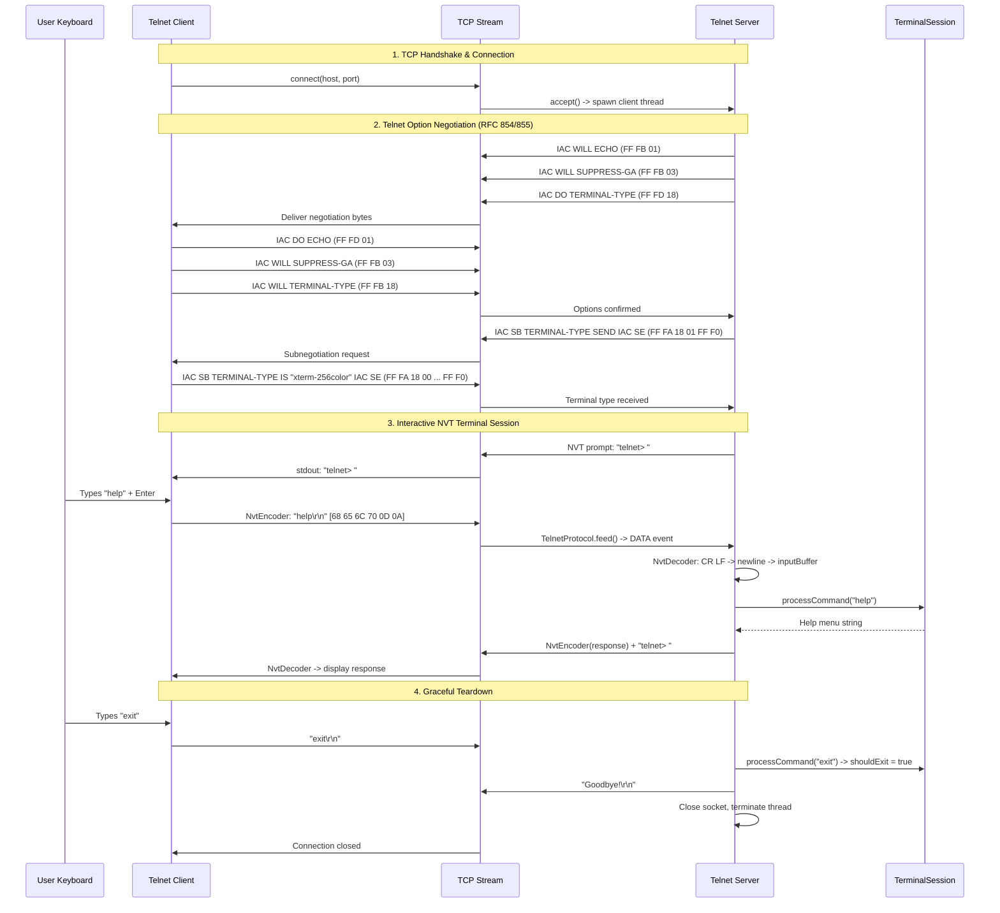

# Telnet Protocol Implementation in C++17

A complete, modular, RFC-compliant implementation of the **Telnet application-layer protocol** (RFC 854, RFC 855, RFC 857, RFC 858, RFC 1091) written in modern C++17 for Computer Networks laboratory projects and academic demonstrations.

Unlike simple raw TCP chat utilities, this is a **genuine Telnet protocol implementation** featuring a stateful IAC command parser, NVT (Network Virtual Terminal) encoding/decoding, RFC 1143 Q-method option negotiation with loop prevention, subnegotiation parameter exchange (TERMINAL-TYPE), and a sandboxed interactive terminal session interpreter.

Runs natively on both **Windows (Winsock2)** and **Linux / macOS (POSIX)** with zero external networking dependencies.

---

## 1. What is Telnet?

Telnet (Telecommunication Network) is an application-layer client-server protocol standardized in **RFC 854** (1983). It establishes an interactive, bidirectional 8-bit byte-oriented communications facility over a reliable TCP transport connection.

The core concept is the **Network Virtual Terminal (NVT)**: an imaginary, canonical terminal device with standardized character conventions that shields clients and servers from the architectural idiosyncrasies of diverse hardware terminals and operating systems.

---

## 2. Client–Server Architecture

The system consists of two independent executables:

- **`telnet_server`**: Multi-threaded TCP server. Listens on a designated port, accepts incoming client connections, spawns an isolated worker thread per client, executes option negotiation, parses NVT data streams, and evaluates terminal commands.
- **`telnet_client`**: Interactive terminal client. Connects to the server, exchanges initial Telnet option negotiation, and concurrently multiplexes user keyboard input (stdin) and incoming server network packets.



---

## 3. User Authentication System

The server enforces multi-user authentication before granting access to the terminal session.

### Authorized Credentials Table

| User # | Username | Password | Access Role |
|:---:|---|---|---|
| 1 | `Prosenjit` | `Prosenjit123` | Full Terminal Access |
| 2 | `Sayak` | `Sayak123` | Full Terminal Access |
| 3 | `Sahid` | `Sahid123` | Full Terminal Access |
| 4 | `Snehasis` | `Snehasis123` | Full Terminal Access |

### Authentication Features:
- **Masked Password Entry**: When typing the password, characters are masked on the screen as `****` to prevent shoulder-surfing.
- **Case-Insensitive Username**: Usernames can be typed in any casing (`prosenjit`, `PROSENJIT`, or `Prosenjit`).
- **Exact-Match Password**: Passwords require exact case matching.
- **Brute-Force Protection**: After 3 consecutive failed login attempts, the server automatically disconnects the client.
- **Personalized Prompt**: Once logged in, the shell prompt displays `<Username>@telnet> ` (e.g. `Prosenjit@telnet> `).

---

## 4. Modular Architecture Layers

The implementation enforces a strict separation of concerns across 4 layers:

| Layer | Files | Description |
|---|---|---|
| **Socket Layer** | `include/socket.hpp`, `src/socket.cpp` | RAII socket wrapper handling socket creation, binding, listening, non-blocking mode, timeouts, cross-platform Winsock2/POSIX compatibility, and reliable `sendAll()` streaming. |
| **NVT Layer** | `include/nvt.hpp`, `src/nvt.cpp` | Stateless `NvtEncoder` (CRLF conversions, IAC escaping) and stateful `NvtDecoder` (incremental reconstruction across TCP packet fragmentation). |
| **Protocol Layer** | `include/telnet_protocol.hpp`, `src/telnet_protocol.cpp` | 5-state IAC command parser, RFC 1143 Q-method loop-prevention state machine, SB/SE subnegotiation parser, and option negotiation handlers. |
| **Application Layer** | `include/terminal_session.hpp`, `src/terminal_session.cpp` | Safe in-memory command interpreter (`help`, `echo`, `date`, `pwd`, `clear`, `exit`). Never executes shell commands or `system()`. |

---

## 4. Protocol Details

### 4.1 NVT (Network Virtual Terminal) Encoding
- **Newlines**: All line terminators on the wire must be sent as `CR LF` (`0x0D 0x0A`).
- **Carriage Return**: A standalone carriage return without linefeed is transmitted as `CR NUL` (`0x0D 0x00`).
- **IAC Escaping**: Any application data byte with value `0xFF` (255 decimal) is escaped on the wire as `IAC IAC` (`0xFF 0xFF`).

### 4.2 Telnet Control Commands
The IAC byte (`0xFF`) triggers the command parser:

| Command | Hex | Dec | Meaning |
|---|---|---|---|
| **SE** | `0xF0` | 240 | Subnegotiation End |
| **NOP** | `0xF1` | 241 | No Operation |
| **DM** | `0xF2` | 242 | Data Mark (Synch) |
| **BRK** | `0xF3` | 243 | NVT Break character |
| **IP** | `0xF4` | 244 | Interrupt Process |
| **AO** | `0xF5` | 245 | Abort Output |
| **AYT** | `0xF6` | 246 | Are You There? |
| **EC** | `0xF7` | 247 | Erase Character |
| **EL** | `0xF8` | 248 | Erase Line |
| **GA** | `0xF9` | 249 | Go Ahead signal |
| **SB** | `0xFA` | 250 | Subnegotiation Begin |
| **WILL** | `0xFB` | 251 | Proposal/agreement to enable option locally |
| **WON'T** | `0xFC` | 252 | Refusal/demand to disable option locally |
| **DO** | `0xFD` | 253 | Request/agreement for remote to enable option |
| **DON'T** | `0xFE` | 254 | Demand for remote to disable option |
| **IAC** | `0xFF` | 255 | Interpret As Command |

### 4.3 Supported Options
- **ECHO (`0x01`, RFC 857)**: Negotiated so the server echoes keystrokes back to the client.
- **SUPPRESS-GO-AHEAD (`0x03`, RFC 858)**: Suppresses the half-duplex Go-Ahead signal, enabling interactive full-duplex communication.
- **TERMINAL-TYPE (`0x18`, RFC 1091)**: Negotiated via SB/SE. The server sends `SEND` (`0x01`); the client responds with `IS` (`0x00`) and `"xterm-256color"`.

### 4.4 Loop Prevention (RFC 1143 Q-Method)
Telnet negotiations are vulnerable to infinite loop storms if both peers echo requests. Our `TelnetProtocol` class implements state tracking (`NO`, `YES`, `WANTYES`, `WANTNO`):
- An option request is only transmitted if the option is not already enabled or pending.
- Unsupported options are explicitly rejected with `WONT` or `DONT`, preventing silent stalls.

---

## 5. Terminal Session Commands

The server processes remote commands through a sandboxed C++ interpreter:

| Command | Example | Output |
|---|---|---|
| `help` | `help` | Displays available commands and academic usage notice |
| `echo <text>` | `echo Hello World` | Returns arguments verbatim (`Hello World\r\n`) |
| `date` | `date` | Returns current server timestamp (e.g. `2026-11-15 18:20:00`) |
| `pwd` | `pwd` | Returns safe working directory path (using `std::filesystem`) |
| `clear` | `clear` | Transmits ANSI escape code `\033[2J\033[H` to clear terminal |
| `exit` | `exit` | Closes session gracefully with `"Goodbye!\r\n"` |

---

## 6. Project Directory Structure

```text
telnet-project/
├── CMakeLists.txt              # Cross-platform CMake build configuration
├── build.bat                   # 1-click Windows standalone build script
├── build_windows.bat           # Alias build script for Windows
├── README.md                   # Complete protocol documentation
├── viva_prep.md                # Comprehensive viva questions and answers
├── flow_diagram.md             # Mermaid flow diagrams source
├── flow_diagram.png            # High-resolution (300 DPI) flow diagram graphic
├── flow_diagram.svg            # Scalable vector flow diagram
├── .gitignore                  # Git ignore rules for build artifacts
│
├── include/
│   ├── socket.hpp              # Cross-platform socket wrapper (Winsock2 + POSIX)
│   ├── nvt.hpp                 # NVT encoding & incremental decoding
│   ├── telnet_protocol.hpp     # IAC command parser & option negotiation
│   ├── terminal_session.hpp    # Sandboxed command interpreter
│   ├── telnet_server.hpp       # Multi-threaded Telnet server class
│   └── telnet_client.hpp       # Interactive Telnet client class
│
├── src/
│   ├── socket.cpp              # Socket compilation unit
│   ├── nvt.cpp                 # NVT compilation unit
│   ├── telnet_protocol.cpp     # Protocol state machine implementation
│   ├── terminal_session.cpp    # Command processor implementation
│   ├── telnet_server.cpp       # Server loop & client thread handling
│   ├── telnet_client.cpp       # Client I/O multiplexing & negotiation
│   ├── server.cpp              # telnet_server main entry point
│   └── client.cpp              # telnet_client main entry point
│
└── tests/
    ├── test_nvt.cpp            # NVT encoder/decoder unit tests (11 tests)
    ├── test_protocol.cpp       # Protocol parser & negotiation tests (20 tests)
    ├── test_session.cpp        # Command interpreter tests (16 tests)
    └── integration_test.cpp    # End-to-end integration test suite
```

---

## 7. How to Build

### Option A: Windows (1-Click Standalone Build)
Open Command Prompt or PowerShell in the `telnet-project` directory and run:

```bat
build.bat
```

This compiles completely self-contained standalone `.exe` binaries with `-static` and links `ws2_32.lib`. No external DLLs are required.

### Option B: Linux / macOS / CMake
```bash
cmake -S . -B build
cmake --build build
```

---

## 8. How to Run

### Step 1: Start the Server (Terminal 1)
```powershell
# Windows:
.\build\telnet_server.exe 5000

# Linux/macOS:
./build/telnet_server 5000
```
Output:
```text
Telnet server listening on port 5000
```

### Step 2: Start the Client (Terminal 2)
```powershell
# Same machine:
.\build\telnet_client.exe 127.0.0.1 5000

# Over Local Area Network (LAN):
.\build\telnet_client.exe 192.168.1.105 5000
```
You will be prompted for credentials:
```text
====================================================
   Telnet Application Server (Academic Demo C++17) 
====================================================
Authorized access only.

Username: Prosenjit
Password: ************

[+] Authentication successful! Welcome, Prosenjit.
Type 'help' to view available commands.

Prosenjit@telnet> help
Available commands:
  help          - Show this help message
  echo <args>   - Print arguments back
  date          - Show current date and time
  pwd           - Print working directory
  clear         - Clear the terminal screen
  exit          - Close the session

Prosenjit@telnet> date
2026-11-16 10:25:00

Prosenjit@telnet> echo Computer Networks Lab
Computer Networks Lab

Prosenjit@telnet> exit
Goodbye!

[Connection closed]
```

---

## 9. Testing

Run all unit tests to verify protocol correctness:

```powershell
.\build\test_nvt.exe
.\build\test_protocol.exe
.\build\test_session.exe
```

### Test Coverage Summary:
- **`test_nvt.exe` (11/11 Passed)**: Plaintext passthrough, CR to CRLF translation, IAC escaping (`0xFF` $\rightarrow$ `0xFF 0xFF`), incremental decode across chunk boundaries, CR-NUL handling.
- **`test_protocol.exe` (20/20 Passed)**: IAC NOP, WILL/WONT/DO/DONT parsing, RFC 1143 Q-method loop prevention, SB/SE subnegotiation decoding, escaped IAC inside SB payloads, fragmented IAC handling across packets, unsupported option rejection.
- **`test_session.exe` (16/16 Passed)**: Verification of `help`, `echo`, `date`, `pwd`, `clear`, `exit`, case-insensitivity, whitespace trimming, and error feedback for unknown commands.

---

## 10. Security Considerations

> **ACADEMIC NOTICE**: Telnet transmits all data—including option bytes, commands, and text—in **cleartext** without encryption or mutual authentication.
> 
> - **Sniffing Risk**: Any packet analyzer (e.g. Wireshark) on the local network path can capture session traffic.
> - **Production Alternative**: In production environments, **SSH (Secure Shell, RFC 4251)** must be used.
> - **Restricted Execution**: To prevent command injection attacks, this server uses a hardcoded restricted command interpreter. It **never invokes `system()` or `/bin/sh`** with client input.
