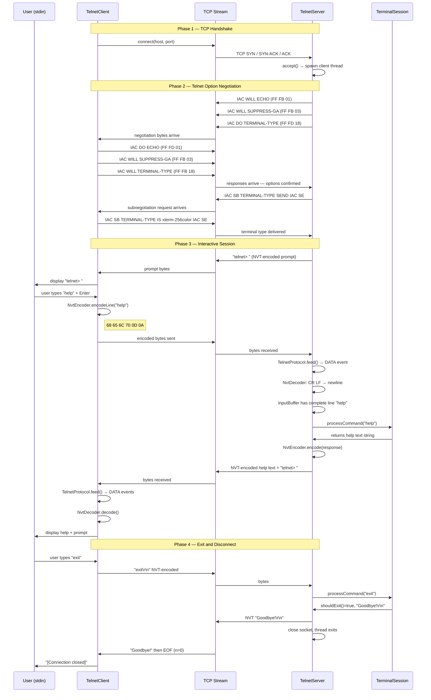
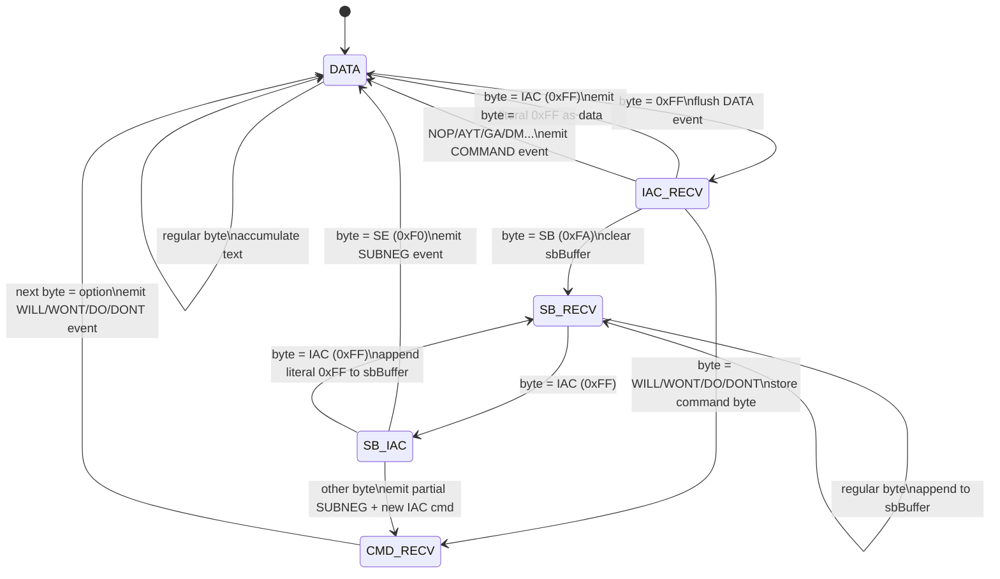
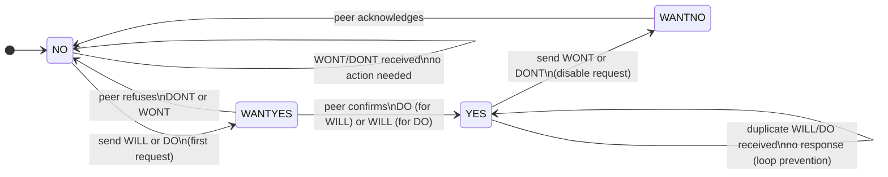
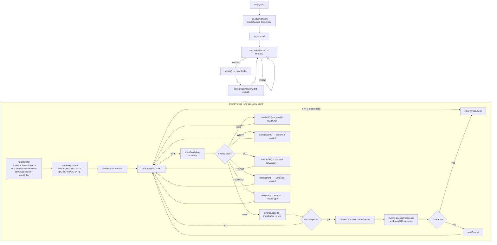
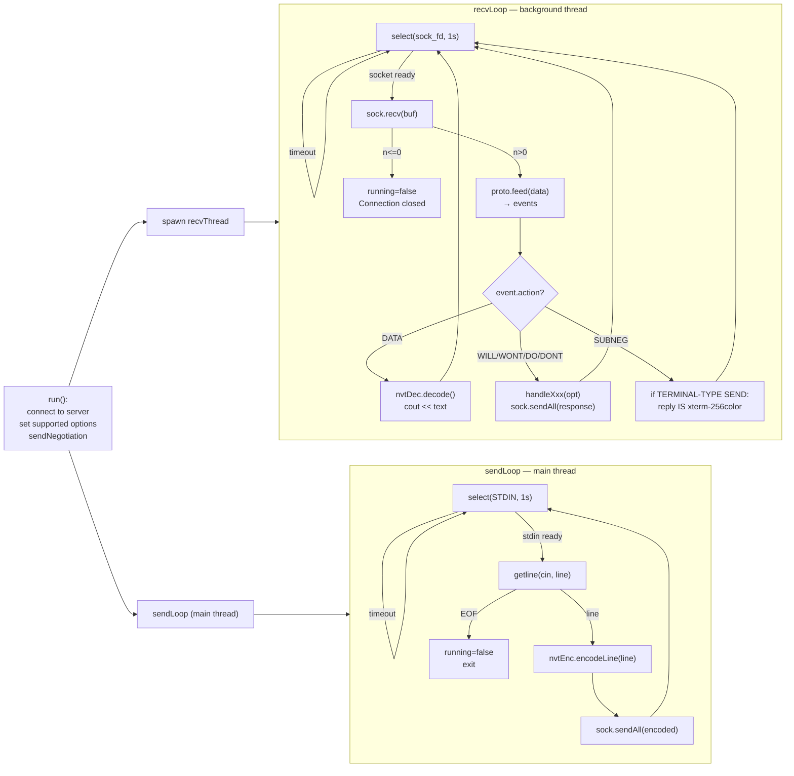
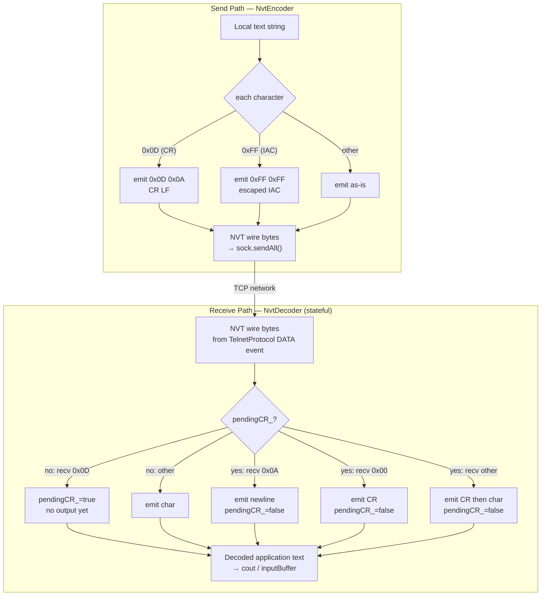
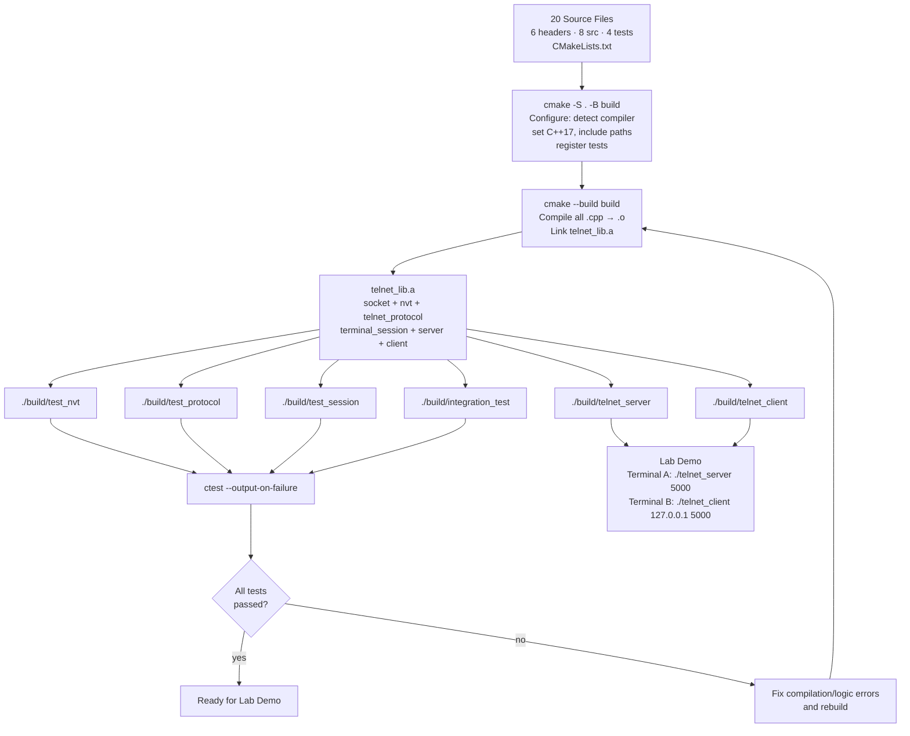

 Telnet Project — Complete Flow Diagrams

## 1. Full Client–Server Communication Sequence

---

## 2. IAC Parser State Machine

---

## 3. Option Negotiation Q-Method States (RFC 1143)

---

## 4. Server Threading Architecture

---

## 5. Client I/O Multiplexing with select()

---

## 6. NVT Encode / Decode Pipeline

---

## 7. Build and Test Pipeline

